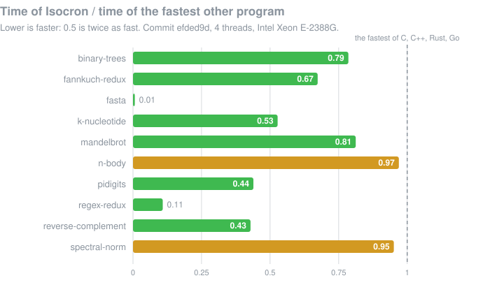

<p align="center">
  
  
</p>

<p align="center">
  <b>A functional array language for raw CPU speed,<br>with the same bits on every machine.</b>
</p>

<p align="center">
  <a href="https://github.com/jbillard/isocron/releases/latest"></a>
  <a href="LICENSE"></a>
  
</p>

<p align="center">
  <a href="#get-started">Get started</a> ·
  <a href="docs/language.md">The language</a> ·
  <a href="results/benchmarks_game.md">Benchmarks</a> ·
  <a href="results/floors.md">Floors</a> ·
  <a href="tools/vscode/README.md">VS Code</a>
</p>

Write `map`, `reduce`, `filter` and `fold` over arrays, in a syntax close to
TypeScript. Isocron fuses them into loops without arrays in between, runs
them on the SIMD lanes of the CPU and on every core, and still gives the
same result, to the last bit, on any machine and for any number of threads.

```ts
// harmonic.isc: one billion terms, on every core
action main(args: string[k]): i32 {
    const n = parseI64(args[0]);
    print(sum(map(iota(n), (i) => 1.0 / f64(i + 1))));
    return 0;
}
```

```console
$ iscc build harmonic.isc
$ ISC_THREADS=1 ./harmonic 1000000000     # 628 ms on one core
21.30048150234794
$ ISC_THREADS=8 ./harmonic 1000000000     # 80 ms on eight, the same bits
21.30048150234794
```

## Isocron is fast

The fastest on the ten programs of [The Computer Language Benchmarks
Game](https://benchmarksgame-team.pages.debian.net/benchmarksgame/), against
the fastest programs in C, C++, Rust and Go, all built and measured in the
same Docker image on the same machine
([protocol](bench/benchmarks_game/protocol.md)).

<!-- results:begin -->

**Isocron is the fastest on 10 of the 10 programs of the Benchmarks Game** (commit `c77e61b`, DECISIONS D262; 4 threads, Intel Xeon E-2388G; [details](results/benchmarks_game.md), [floors](results/floors.md)).

| | benchmark | Isocron | fastest other | Isocron / fastest | floor | Isocron / floor |
| :-: | :-- | --: | :-- | :-: | --: | :-: |
| 🟢 | binary-trees | 669 ms | Rust 868 ms | $\color{green}{\textbf{0.77}}$ | 394.7 ms | $\color{orange}{1.7}$ |
| 🟢 | fannkuch-redux | 1663 ms | C 2467 ms | $\color{green}{\textbf{0.67}}$ | 883.5 ms | $\color{orange}{1.9}$ |
| 🟢 | fasta | 18 ms | Rust 755 ms | $\color{green}{\textbf{0.02}}$ | 2.3 ms | $\color{red}{7.8}$ |
| 🟢 | k-nucleotide | 1070 ms | C++ 1176 ms | $\color{green}{\textbf{0.91}}$ | 268.0 ms | $\color{red}{4.0}$ |
| 🟢 | mandelbrot | 639 ms | C++ 796 ms | $\color{green}{\textbf{0.80}}$ | 436.3 ms | $\color{green}{1.5}$ |
| 🟡 | n-body | 1897 ms | C 1945 ms | $\color{orange}{\textbf{0.98}}$ | 1315.5 ms | $\color{green}{1.4}$ |
| 🟢 | pidigits | 490 ms | C 681 ms | $\color{green}{\textbf{0.72}}$ | 194.4 ms | $\color{orange}{2.5}$ |
| 🟢 | regex-redux | 289 ms | Rust 754 ms | $\color{green}{\textbf{0.38}}$ | 29.7 ms | $\color{red}{9.7}$ |
| 🟢 | reverse-complement | 61 ms | Rust 67 ms | $\color{green}{\textbf{0.91}}$ | 16.8 ms | $\color{red}{3.6}$ |
| 🟡 | spectral-norm | 195 ms | Rust 205 ms | $\color{orange}{\textbf{0.95}}$ | 107.1 ms | $\color{orange}{1.8}$ |

🟢 Isocron the fastest · 🟡 within 5 % of the fastest · 🔴 behind. Over the floor: $\color{green}{\text{up to 1.5}}$, $\color{orange}{\text{up to 3}}$, $\color{red}{\text{beyond}}$.

<p align="center"></p>

<!-- results:end -->

## Isocron is exact

The same program gives the same bits everywhere: one core or sixteen, AVX2
or AVX-512, Linux, Windows or WebAssembly.

* **No fast-math.** The compiler never reorders a floating-point sum,
  never fuses a product and a sum into one instruction, and keeps every
  operation as it is written.
* **A fixed order of reduction.** `sum`, `reduce` and their kin combine
  their elements in an order set by the language (section 10 of the
  specification), not by the number of threads or the width of the vectors.
* **An oracle.** A reference interpreter (`iscc run`) gives the bits every
  compiled program must give; the tests compare them, bit for bit.

## Isocron is parallel, without threads

No threads, no locks, no intrinsics to write. The functions of arrays are
the parallel loops:

```ts
function stdDev(x: f64[n]): f64 {
    const m = mean(x);
    return sqrt(sum((x - m) ** 2) / f64(n));
}
```

`x - m` and `** 2` work element by element; `(x - m) ** 2` is fused into
the `sum` that reads it, so no array is made for it, and each pass over `x`
runs in vector code on every core.

## Isocron checks before it runs

Functions are pure; reading files, printing and the clock are `action`s.
Sizes are part of the types (`f64[n]`), so the compiler finds the
mismatches it can see:

```ts
function add(a: f64[n], b: f64[n]): f64[n] {
    return a + b;
}
action main(args: string[k]): i32 {
    print(add([1.0, 2.0], [3.0, 4.0, 5.0]));
    return 0;
}
```

```console
$ iscc check sizes.isc
sizes.isc:5:27: error: size mismatch: expected `f64[2]`, found `f64[3]`
```

Sizes it cannot compare (`a: f64[n], b: f64[m]`) are checked once at run
time, with the place in the source: `panic at line 2, column 14: size
mismatch: 2 != 3`.

## Measured against the machine

Beating C is not the goal: the machine is. Each program has a *floor*, what
its result requires at the cost of the cheapest way this processor has to
do it, and [`results/floors.md`](results/floors.md) says, program by
program, where the time above it still goes.

Each form of the language is measured the same way: a microbenchmark of
the form in Isocron, against the same work written in C the cheapest way
known, on one core at fixed frequency.
[`results/primitives.md`](results/primitives.md) ranks them by their gap to
that floor, and the work goes from the largest gap down (the strings first,
DECISIONS D301 to D305).

## Get started

### Install

The compiler of a release needs nothing else: LLVM, its linker and what
they link programs with are inside. Linux x86-64 (glibc 2.28 or later) and
Windows 10 and 11:

```sh
curl -LO https://github.com/jbillard/isocron/releases/download/v0.2.1/isocron-0.2.1-x86_64-linux.tar.gz
tar -xzf isocron-0.2.1-x86_64-linux.tar.gz
./isocron-0.2.1-x86_64-linux/iscc --version
```

On Windows, unpack `isocron-0.2.1-x86_64-windows.zip` from the
[releases](https://github.com/jbillard/isocron/releases) and run `iscc.exe`.
Beside the compiler, `isc-lsp` is the language server of the editors
([editors](docs/language.md#editors-the-language-server-isc-lsp)).

### Hello

```ts
action main(args: string[k]): i32 {
    print("Hello, Isocron!");
    return 0;
}
```

```sh
iscc run hello.isc                             # the interpreter
iscc build hello.isc && ./hello                # a native program
iscc build hello.isc --target x86_64-windows   # hello.exe
iscc build hello.isc --target wasm32-wasi      # hello.wasm
```

### Write

* [`docs/language.md`](docs/language.md), the language as it is implemented,
  with a program and its output for each feature (and what is
  [not there yet](docs/language.md#not-implemented-yet)).
* [`examples/benchmarks_game`](examples/benchmarks_game): the ten programs of
  the Benchmarks Game.
* **VS Code**: [`tools/vscode`](tools/vscode/README.md), colors, the errors of
  `iscc check` in the editor, the types and the documentation on hover, run,
  build, the IR, outline and definitions.
* **Any editor**: `isc-lsp`, the language server (the errors as the text is
  typed, the types and the documentation on hover, the definitions, the
  outline), [for Neovim](tools/neovim/isocron.lua) and the others
  ([editors](docs/language.md#editors-the-language-server-isc-lsp)).
* **The shell**: `source <(iscc completions bash)` (or `zsh`, `fish`) completes
  the commands, their options and the `.isc` files.

## The project

| Document | What it holds |
| :-- | :-- |
| [`SPEC.md`](SPEC.md) | the specification, the source of truth (in French) |
| [`docs/language.md`](docs/language.md) | the language as implemented today |
| [`DECISIONS.md`](DECISIONS.md) | every choice made where the specification is silent, with its measurements |
| [`TODO.md`](TODO.md) | the tasks P0 to P6, done and to do |
| [`results/`](results/README.md) | the measurements: the Benchmarks Game, the floors, every form against its floor, the kernels of the proof of concept |
| [`CHANGELOG.md`](CHANGELOG.md) | the releases |

<details>
<summary><b>Build from source</b></summary>

Rust (stable), a C compiler and linker (`cc`), and the LLVM 21 shared
library (`libLLVM-21.so`, e.g. the Ubuntu package `libllvm21`); set
`ISC_LLVM_LIB_DIR` if it is not in `/usr/lib/x86_64-linux-gnu`. For the
benchmarks: GCC, Go, Zig 0.14, `taskset`, Python 3; Docker for the
Benchmarks Game.

```sh
cargo build --release
target/release/iscc check examples/poc/sum.isc
target/release/iscc ir    examples/poc/sum.isc                          # the optimized IR
target/release/iscc run   examples/poc/sum.isc in.f64 out.f64 100       # the interpreter
target/release/iscc build examples/poc/sum.isc -o sum                   # a native program
ISC_THREADS=4 ./sum in.f64 out.f64 100   # on 4 threads: the same result for any number of threads
```

More options:

```sh
target/release/iscc build examples/poc/sum.isc -o sum --emit-asm sum.s --emit-llvm sum.ll   # --debug keeps symbols
ISC_ALLOC=glibc target/release/iscc build examples/poc/sum.isc -o sum-glibc   # linked with glibc (a program without C functions is static, without it)
ISC_ALLOC=glibc ./sum-glibc in.f64 out.f64 100   # glibc's allocator instead of Isocron's
target/release/iscc build examples/poc/sum.isc -o sum64 --lanes 64 --isa sse   # experiment: V = 64 (the language fixes 32), SSE4.2 code
target/release/iscc build examples/poc/sum.isc --target wasm32-wasi   # sum.wasm, a WASI module
wasmtime run --dir=/::/ sum.wasm $PWD/in.f64 $PWD/out.f64 100
target/release/iscc build examples/poc/sum.isc --target wasm32-wasi-threads   # with threads (wasi-threads)
wasmtime run -W threads=y -S threads=y --env ISC_THREADS=8 --dir=/::/ sum.wasm $PWD/in.f64 $PWD/out.f64 100
ISC_MINGW_DIR=/usr target/release/iscc build examples/poc/sum.isc --target x86_64-windows   # sum.exe, for Windows (MinGW-w64)
```

The compilers of a release are built by `tools/release` (LLVM 21.1.8 and
LLD as static libraries, in Docker):

```sh
docker build -t isocron-release-linux tools/release/linux
docker build -t isocron-release-windows tools/release/windows
# in each image: tools/release/build_llvm.sh, then tools/release/build_iscc.sh
tools/release/selftest_linux.sh <iscc> target/release/iscc           # in minimal systems, without network
tools/release/selftest_windows.py <iscc.exe> target/release/iscc     # on the Windows machine of tools/windows/run.py
```

Messages are in colors, with the line of the source under an error, when
the error output is a terminal and `NO_COLOR` is not set; `--color always`
or `--color never` (anywhere on the command line) forces the choice.

</details>

<details>
<summary><b>Tests</b></summary>

```sh
cargo test
ISC_ALLOC=glibc cargo test                     # the same with glibc's allocator
python3 tools/suite.py . target suite.log 6    # both at once: 3 minutes instead of 13
```

The suite covers the lexer and parser (all examples of the specification),
positive and negative typing cases, the IR passes (fusion, in-place update,
`requireUnique`), the interpreter against an independent implementation of
the fixed reduction form, compiled programs against the interpreter bit for
bit (several sizes, a three-level reduction, panics, printing), SIMD and the
absence of fast-math flags in the generated code, memory under valgrind, and
differential testing on random programs (`ISC_DIFF_PROGRAMS` and
`ISC_DIFF_SEED` widen the campaign).

</details>

<details>
<summary><b>Benchmarks</b></summary>

```sh
bench/build.sh                              # the programs of the proof of concept into bench/bin
bench/run.py                                # protocol of section 14: results/poc.md and results/poc.json
bench/benchmarks_game/run.sh measure 4 3 native > results/benchmarks_game.tsv   # the ten programs, in Docker
bench/floor/run.sh > results/machine_floor.txt                                    # the costs of the machine
bench/machine.sh apply && python3 bench/primitives/run.py; bench/machine.sh restore  # every form against its floor in C: results/primitives.md
```

</details>

<details>
<summary><b>Layout of the repository</b></summary>

| Path | Content |
| :-- | :-- |
| `crates/isc-syntax` | lexer (offside rule), parser, AST, positioned diagnostics |
| `crates/isc-types` | type checker (literal typing, size polynomials, run-time size tests), standard library `prelude.isc` |
| `crates/isc-ir` | high-level IR, lowering (full inlining, specialization), the passes (fusion, tables of functions, lengths known before running), ownership analysis |
| `crates/isc-interp` | reference interpreter (bit-exact oracle) |
| `crates/isc-codegen` | IR to LLVM IR (fusion F1, fixed-form vectorized reduction, in-place updates, vector code, `bench`), LLVM C API back-end |
| `crates/isc-runtime` | runtime of compiled programs, without the Rust standard library: its allocator, the thread pool, I/O actions, printing, clock, panics (its own workspace, built and embedded by `crates/iscc/build.rs`) |
| `crates/isc-runtime-core` | texts, formatting, big integers and regular expressions shared by the runtime and the interpreter (`no_std`) |
| `crates/iscc` | the `iscc` driver and the end-to-end tests |
| `crates/isc-lsp` | the language server of the editors (`isc-lsp`): the parser and the checker as libraries, the protocol on stdio |
| `examples` | the programs of the proof of concept (`poc`) and of the Benchmarks Game (`benchmarks_game`) |
| `bench` | reference programs, the protocols, the floors of the machine (`bench/floor`), every form of the language against its floor in C (`bench/primitives`) |
| `tools` | `suite.py`: the complete suite in a few minutes; `release/`: the compilers and archives of a release, `publish.sh`; `vscode/`: the extension of VS Code; `neovim/`: the configuration of Neovim |

</details>

## License

MIT: [`LICENSE`](LICENSE). The notices of the parts of other projects that a
release contains: [`tools/release/THIRD_PARTY_LICENSES.md`](tools/release/THIRD_PARTY_LICENSES.md).
