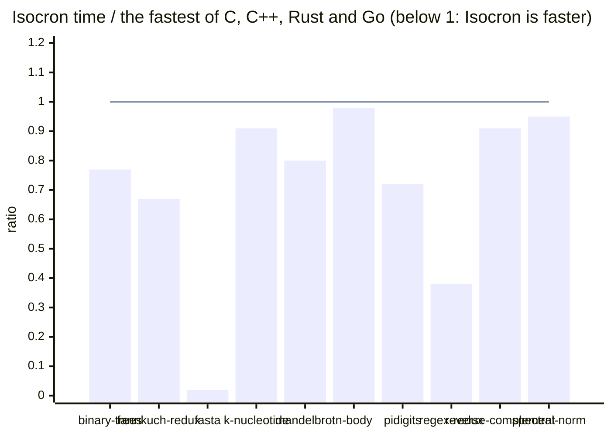

# The ten programs of the Benchmarks Game

> [!NOTE]
> **Intermediate results**: Isocron at commit `c77e61b` (DECISIONS D262), 2026-11-04. The work on the ten programs goes on, and these numbers will change. Generated by `bench/benchmarks_game/report.py` from `results/benchmarks_game.tsv` (the raw lines of `bench/benchmarks_game/measure.sh`).

**Isocron is the fastest on 10 of the 10 programs.** Elapsed time in milliseconds, the lowest of 3 runs, at the sizes of the Benchmarks Game, 4 threads, in Docker on an Intel Xeon E-2388G ([protocol](#protocol)). The *floor* is what the result requires at the cost of the cheapest way the machine has to do it, never the time of a program ([floors.md](floors.md)). Isocron's programs use no intrinsics and no library of their own: the compiler makes their vector code and their parallel code.

| | benchmark | floor | C | C++ | Rust | Go | Isocron | Isocron / fastest | Isocron / floor |
| :-: | :-- | --: | --: | --: | --: | --: | --: | :-: | :-: |
| 🟢 | **binary-trees** | 394.7 | 1021 | 2098 | 868 | 8356 | **669** | $\color{green}{\textbf{0.77}}$ | $\color{orange}{1.7}$ |
| 🟢 | **fannkuch-redux** | 883.5 | 2467 | 3822 | 4145 | 7101 | **1663** | $\color{green}{\textbf{0.67}}$ | $\color{orange}{1.9}$ |
| 🟢 | **fasta** | 2.3 | 760 | 756 | 755 | 1154 | **18** | $\color{green}{\textbf{0.02}}$ | $\color{red}{7.8}$ |
| 🟢 | **k-nucleotide** | 268.0 | 1922 | 1176 | 1519 | 3022 | **1070** | $\color{green}{\textbf{0.91}}$ | $\color{red}{4.0}$ |
| 🟢 | **mandelbrot** | 436.3 | 1062 | 796 | 874 | 3364 | **639** | $\color{green}{\textbf{0.80}}$ | $\color{green}{1.5}$ |
| 🟡 | **n-body** | 1315.5 | 1945 | 1983 | 1947 | 3532 | **1897** | $\color{orange}{\textbf{0.98}}$ | $\color{green}{1.4}$ |
| 🟢 | **pidigits** | 194.4 | 681 | 748 | 745 | 763 | **490** | $\color{green}{\textbf{0.72}}$ | $\color{orange}{2.5}$ |
| 🟢 | **regex-redux** | 29.7 | 878 | 994 | 754 | 16693 | **289** | $\color{green}{\textbf{0.38}}$ | $\color{red}{9.7}$ |
| 🟢 | **reverse-complement** | 16.8 | 70 | 156 | 67 | 172 | **61** | $\color{green}{\textbf{0.91}}$ | $\color{red}{3.6}$ |
| 🟡 | **spectral-norm** | 107.1 | 314 | 399 | 205 | 456 | **195** | $\color{orange}{\textbf{0.95}}$ | $\color{orange}{1.8}$ |

🟢 Isocron the fastest · 🟡 within 5 % of the fastest · 🔴 behind. Over the floor: $\color{green}{\text{up to 1.5}}$, $\color{orange}{\text{up to 3}}$, $\color{red}{\text{beyond}}$. The fastest of the four other languages in **bold**, or Isocron when it is faster.

<b>Against the programs without intrinsics nor libraries</b>: the fastest of the four measured programs that use neither x86 intrinsics nor a library of their own (GMP, PCRE)

| benchmark | fastest plain | Isocron / plain |
| :-- | :-- | :-: |
| binary-trees | Rust 868 | $\color{green}{\textbf{0.77}}$ |
| fannkuch-redux | Go 7101 | $\color{green}{\textbf{0.23}}$ |
| fasta | C 760 | $\color{green}{\textbf{0.02}}$ |
| k-nucleotide | C++ 1176 | $\color{green}{\textbf{0.91}}$ |
| mandelbrot | Rust 874 | $\color{green}{\textbf{0.73}}$ |
| n-body | Go 3532 | $\color{green}{\textbf{0.54}}$ |
| pidigits | – | – |
| regex-redux | Go 16693 | $\color{green}{\textbf{0.02}}$ |
| reverse-complement | Go 172 | $\color{green}{\textbf{0.35}}$ |
| spectral-norm | Go 456 | $\color{green}{\textbf{0.43}}$ |

<b>What the measured programs use beyond their language</b> (lines of their source that name x86 intrinsics, GMP or PCRE; a search of words, not a reading of the programs)

| benchmark | language | program | uses |
| :-- | :-- | :-- | :-- |
| fannkuch-redux | C | gcc-6 | SIMD (36 lines) |
| fannkuch-redux | C++ | gpp-6 | SIMD (44 lines) |
| fannkuch-redux | Rust | rust-6 | SIMD (10 lines) |
| fasta | C++ | gpp-9 | SIMD (12 lines) |
| fasta | Rust | rust-7 | SIMD (16 lines) |
| mandelbrot | C | gcc-6 | SIMD (14 lines) |
| mandelbrot | C++ | gpp-4 | SIMD (27 lines) |
| n-body | C | gcc-9 | SIMD (77 lines) |
| n-body | C++ | gpp-0 | SIMD (74 lines) |
| n-body | Rust | rust-9 | SIMD (82 lines) |
| pidigits | C | gcc-2 | GMP (25 lines) |
| pidigits | C++ | gpp-4 | GMP (4 lines) |
| pidigits | Rust | rust-4 | GMP (1 lines) |
| pidigits | Go | go-4 | GMP (19 lines) |
| regex-redux | C | gcc-5 | PCRE (25 lines) |
| regex-redux | C++ | gpp-6 | PCRE (78 lines) |
| regex-redux | Rust | rust-7 | PCRE (26 lines) |
| reverse-complement | C | gcc-7 | SIMD (13 lines) |
| reverse-complement | C++ | gpp-2 | SIMD (17 lines) |
| reverse-complement | Rust | rust | SIMD (17 lines) |
| spectral-norm | C | gcc-6 | SIMD (84 lines) |
| spectral-norm | C++ | gpp-6 | SIMD (9 lines) |
| spectral-norm | Rust | rust-6 | SIMD (9 lines) |

## Notes

* fannkuch-redux: the Isocron program was rewritten twice (D170: by chunks of permutations, without divisions; D197: the flips of a chunk as a `map`, in vector code). Part of its gain comes from the program, not from the language; the nine others are their first version (D160), but for names of the standard library.
* The floors: `results/floors.md` (D222, D227, D233). Every program here, of every language, is still above its floor by 1.4 to 326 times.

## The programs

The fastest of each language on the site of the Benchmarks Game (2026-11-02 and 2026-11-03):

| benchmark | C | C++ | Rust | Go |
| --- | --- | --- | --- | --- |
| binarytrees | gcc-2 | gpp-7 | rust-5 | go-2 |
| fannkuchredux | gcc-6 | gpp-6 | rust-6 | go-3 |
| fasta | gcc-3 | gpp-9 | rust-7 | go-2 |
| knucleotide | gcc | gpp-2 | rust-7 | go-7 |
| mandelbrot | gcc-6 | gpp-4 | rust-4 | go-4 |
| nbody | gcc-9 | gpp-0 | rust-9 | go-3 |
| pidigits | gcc-2 | gpp-4 | rust-4 | go-4 |
| regexredux | gcc-5 | gpp-6 | rust-7 | go-3 |
| revcomp | gcc-7 | gpp-2 | rust | go-6 |
| spectralnorm | gcc-6 | gpp-6 | rust-6 | go-4 |

## Protocol

* Machine: Intel Xeon E-2388G (8 cores, 2 hardware threads per core),
  `bench/machine.sh apply parallel`: governor `performance`, turbo off, the
  frequency fixed, every other process on the sibling threads.
* Every program runs in the Docker image `isocron-bg` without network
  (`bench/benchmarks_game/run.sh measure 4 3 native`), in the slice
  `isc-bench.slice`, on 4 CPUs (the first hardware thread of 4 physical
  cores, as the 4 cores of the machine of the Benchmarks Game), with 4
  threads (`OMP_NUM_THREADS`, `RAYON_NUM_THREADS`, `GOMAXPROCS`,
  `ISC_THREADS`; C++ #4 of mandelbrot starts one thread per CPU of the
  machine).
* Mode `native`: the options of the command lines of the Benchmarks Game
  with the CPU of this machine (`-march=native`, `target-cpu=native`,
  `GOAMD64=v3`, Isocron by default); gcc and g++ 14.2.0, rustc 1.84.1, go
  1.24.4 (Debian trixie; the Benchmarks Game has go 1.23.1).
* Sizes: binary-trees 21, fannkuch-redux 12, fasta 25 000 000, mandelbrot
  16 000, n-body 50 000 000, pidigits 10 000, spectral-norm 5 500;
  k-nucleotide and reverse-complement read the output of fasta 25 000 000,
  regex-redux that of fasta 5 000 000 (made by the fasta of Isocron, whose
  output is the reference's byte for byte).
* Every output is checked first (`run.sh check`): against the reference
  output of the Benchmarks Game, or as `bench/benchmarks_game/README.md`
  says for the two programs that cannot be (C++ #4 of mandelbrot, Go #4 of
  pidigits).

## Choices forced by the image

* Go of regex-redux: #5 (the fastest) and #4 bind PCRE1, which Debian
  trixie no longer has; #3, with the `regexp` of Go, is measured.
* The Rust programs are built with Cargo and one set of dependencies, at
  the versions that build with Rust 1.84.1 (`bench/benchmarks_game/rust`);
  the Benchmarks Game builds them with `rustc` against crates whose versions
  it does not give.

## Reading

Isocron is the fastest on mandelbrot, within a factor of 2 on
fannkuch-redux and fasta, between 2 and 4 on six programs, and 7.5 times
slower on reverse-complement. The causes found so far, and those left to
find, are in TODO ("Performance") and DECISIONS (D164 to D176).
