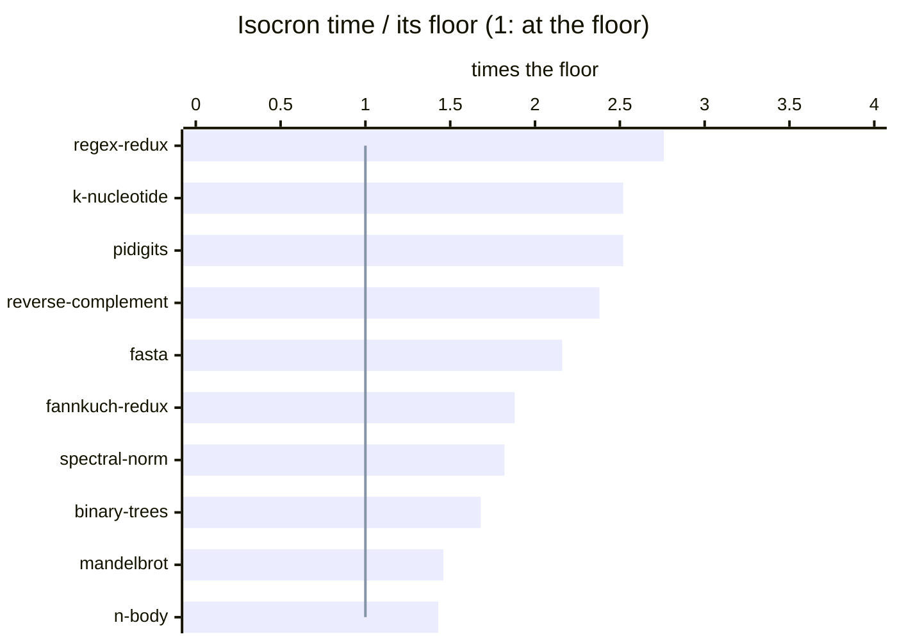

# The floors of the machine

> [!IMPORTANT]
> The floor of a program is what its result requires, under the rules of
> the Benchmarks Game (its algorithm: the trees allocated, the spigot, the
> generator, the hash tables of k-mers), times the cost of the cheapest way
> this machine has to do it. It is **never the time of a program**, ours or
> another, and it **keeps the bits** of the computation as the program
> writes it (no fused multiply-add where a product and a sum are written, no
> reordered sum: D227). A floor that a measured program beats is wrong;
> `floors.py` flags it.

Generated by `bench/floor/floors.py results/machine_floor.txt
results/machine_counts.txt results/floors_isocron.tsv
results/benchmarks_game.tsv results/floors.tsv` (DECISIONS D182, D222,
D227, D233), 2026-11-06. Times of Isocron at commit `f3e1ef8` (D381), 4 threads but
n-body and pidigits (sequential programs), lowest of 12 runs, measured in the
Docker image with the other languages (`results/benchmarks_game.tsv`), on an
Intel Xeon E-2388G at fixed frequency (`bench/machine.sh apply parallel`).

| benchmark | floor | Isocron | Isocron / floor | fastest other | its / floor | model |
| :-- | --: | --: | :-: | :-- | :-: | :-- |
| **binary-trees** | 0.395 s | 0.664 s | $\color{orange}{1.7}$ | rust-5 0.847 s | $\color{orange}{2.1}$ | each node made in an arena and visited through its pointers: 1.47 ns per node (4.42 in memory) |
| **fannkuch-redux** | 0.883 s | 1.659 s | $\color{orange}{1.9}$ | gcc-6 2.463 s | $\color{orange}{2.8}$ | 3.76e+09 flips (0.691 ns, 4 permutations per vector), 4.79e+08 permutations (1.955 ns) |
| **fasta** | 0.002 s | 0.005 s | $\color{orange}{2.2}$ | rust-7 0.754 s | $\color{red}{326.0}$ | one period of the generator (139968 values, 1.029 ns) and its symbols, then 254 MB of lines copied from tables (0.0347 ns a byte) |
| **k-nucleotide** | 0.268 s | 0.676 s | $\color{orange}{2.5}$ | gpp-2 1.164 s | $\color{red}{4.3}$ | read 0.027 s (4 threads), 8.75e8 counts: 0.654 ns (tables of 4096), 2.221 ns (138127 and 139882 keys for 12, 18) |
| **mandelbrot** | 0.436 s | 0.637 s | $\color{green}{1.5}$ | gpp-4 0.786 s | $\color{orange}{1.8}$ | 6.25e+09 iterations x 7.12 operations, 8 lanes per cycle |
| **n-body** | 1.316 s | 1.887 s | $\color{green}{1.4}$ | gcc-9 1.944 s | $\color{green}{1.5}$ | latency of a step 26.3 ns (10 roots and divisions: 15.7 ns) *(estimate)* |
| **pidigits** | 0.194 s | 0.490 s | $\color{orange}{2.5}$ | gcc-2 0.680 s | $\color{red}{3.5}$ | 5.85e+08 passes over a word (mulx, adc: 0.332 ns) |
| **regex-redux** | 0.030 s | 0.082 s | $\color{orange}{2.8}$ | rust-7 0.753 s | $\color{red}{25.3}$ | read 5.4 ms, 6 copies of 50.8 MB at 20.8 GB/s, 9 scans for literals (0.064 ns per byte) *(estimate)* |
| **reverse-complement** | 0.017 s | 0.040 s | $\color{orange}{2.4}$ | rust 0.064 s | $\color{red}{3.8}$ | the file read twice by blocks in the caches, 30.2 GB/s |
| **spectral-norm** | 0.107 s | 0.195 s | $\color{orange}{1.8}$ | rust-6 0.205 s | $\color{orange}{1.9}$ | 1.21e+09 elements: 52 % divided (0.626 ns per core), 48 % read from memory, stored once |

Over the floor: $\color{green}{\text{up to 1.5}}$, $\color{orange}{\text{up to 3}}$, $\color{red}{\text{beyond}}$.

The reference is the machine, not another language: a program at the level
of the fastest of another language can still be far from its floor (the
fastest fasta, in Rust, is 326 times its floor).

## Where the time above each floor goes

Measured at commit `c77e61b` (D263), before D264 to D318 (the times of
fasta, k-nucleotide, regex-redux and reverse-complement have changed since:
the table above, and the work of D264 to D318 in DECISIONS): the sizes of the publication, 4
threads, `perf stat` and `perf record` on the host at fixed frequency (the
same code as in Docker); CPU times summed over the threads; n-body with the
sibling thread of its core offline (D261). Each gap is the part of a
measured component above the term of the floor that does the same work.

| benchmark | Isocron / floor | where the rest goes |
| :-- | :-: | :-- |
| **regex-redux** | 9.7 | Of 877 ms of CPU: the engine of masks (`bounds_from`) 394 ms, where the floor scans for pairs of literals in 34 ms (9 passes at 0.074 ns a byte); the copies 140 ms against 59 ms for the floor's 6: those of the substitutions (about 99 ms) write new pages (`clear_page` 56 ms), the vector of the bounds of matches grows by copies (about 27 ms); the threads of the pool waiting while a step runs on one (`worker`, `parallel_for`) 165 ms. |
| **fasta** | 7.8 | Every number of the generator computed (2e8, 3.5 instructions and 0.33 ns of CPU each: 65 ms of CPU), where the floor computes one period (3 x 139968 numbers) and copies the 254 MB of lines from tables: 9.3 ms of CPU. |
| **k-nucleotide** | 4.0 | Of 3727 ms of CPU: the counts (`add_block`, `count_round`) 2255 ms against 964 ms for the floor's (409 ms in tables of 4096, 555 ms in the tables of 12 and 18 bases): 87 instructions a key of the large frames, about 28 needed (the scatter by rounds, D253); the lines of the text (`isc_task_29`) 520 ms, the refills of the small blocks (`refill`) 233 ms, where the floor only reads the file (108 ms of CPU). |
| **reverse-complement** | 3.6 | Of 242 ms of CPU against 68 ms (the file read twice by blocks): the lines, about 19 ms against about 6 (170 instructions a line of 61 bytes, D199); the output written into new pages (`clear_page` 8 %); the threads waiting at the end of the writing passes of the second and third records (about 2 ms each, D259); the count of the headers at 31.7 GB/s from the pages of the file, against 47.3 GB/s from memory. |
| **pidigits** | 2.5 | Of 504 ms: the product of a number by a word (`mul_word`) 300 ms, a loop of the runtime at the speed of the same loop in C (0.761 ns a word), 2.27 times the chain of `mulx` and `adc` of the floor (0.335 ns); the other operations of the numbers (`op`, `sub`) 181 ms. |
| **fannkuch-redux** | 1.9 | 5.62 cycles a flip, 14.9 instructions with those of the permutations, against 2.21 cycles a flip and 6.25 a permutation: each permutation a number of 64 bits (16 digits of 4 bits), a flip its digits reversed by shifts and masks, the ports 0 and 5 busy 91.5 % and 93.5 % of the cycles; the floor flips 4 permutations of 16 bytes with one byte shuffle. |
| **spectral-norm** | 1.8 | Every element of the matrix divided: the divider active 97.4 % of the cycles, 2.07 cycles an element on 4 cores (0.189 s for 1.21e9 elements at the throughput of the floor); the floor reads 48 % of them from a matrix stored once, at the bandwidth of the memory. |
| **binary-trees** | 1.7 | 12.9 cycles and 43.1 instructions a node, 3.97 ns of CPU: the cost of the recursive primitive (3.494 ns at depth 12, 4.476 at depth 20), for the tree made and for the tree checked (`isc_fn_0_rg` 44 %, `isc_fn_1` 50 %); the floor counts the loop with an explicit stack (1.466 ns at depth 12) for the 4.0e8 nodes of the trees of depth 14 at most. |
| **mandelbrot** | 1.5 | 5.75e10 operations of lanes against 4.45e10 (1.29): the 64 pixels of a group iterate until the last escapes, the lanes already out compute for nothing; the port of the vectors of 512 bits busy 94.2 % of the cycles, 6.6 % of its operations compares and masks. |
| **n-body** | 1.4 | 118.8 cycles a step against 84.0 (the chain of a step, 26.3 ns): a model of the loop (each instruction when its operands are ready, the divider one unit, 4.5 cycles a root and 4 a division held, latencies 18 and 14) gives 98.0 cycles of latency (two shuffles a pair of pairs, the 4 additions in order of each speed) and 101.5 with the divider; the remaining 17 cycles are the ports and the window of the scheduler, which the model leaves out (issue stalls 75 cycles of 128 before D261). |

## Order of the work

Every program is now below three times its floor (the table above, D319,
measured again with the library of D322 to D343 in D344):
regex-redux 9.7 -> 2.8 (its alternatives searched by lanes and groups of
blocks, its parts stopped at the next part, parts per thread taken in
turn, the sizes of a replacement from its search, a text written where
it is: D306 to D315), fasta 7.8 -> 2.2 (the generator in parts from powers
of its step, the start without a huge page for a sentinel, the rows that
take their equality and their remainders out of their loop, the tasks of
a fill of 16 KiB: D292, D316, D318, D321), k-nucleotide 4.0 -> 2.6
(`countBy` by tables of counts only: D317) and reverse-complement 3.6 ->
2.4 (D286 and after). By the gap that is
left: regex-redux (its dense replacements: millions of matches listed and
written), k-nucleotide (the counts of 1 to 6 bases, 31 to 40 ms each
against 20), pidigits (the word loop in `mulx` and `adc`),
reverse-complement, fasta (a line of 61 bytes made by the general code
where the floor copies it from a table), then fannkuch-redux,
spectral-norm, binary-trees, mandelbrot and n-body.

## How the floors are made

<b>The work counted and the costs measured</b>

The work is counted (`bench/floor/counts.c`: flips, permutations,
iterations, k-mers; `floors.py`: the nodes of binary-trees, the passes of
pidigits on the real sizes of its numbers); the costs are measured without
Isocron (`bench/floor/floor.c`, in `results/machine_floor.txt`): bandwidths,
new pages, a file of the page cache read by every thread (into new pages,
into pages already written, by blocks that stay in the caches), an array
changed in place, the divider, square roots, fused multiply-adds,
latencies, random increments, counts in tables of 4096, the nodes of a
tree made in an arena (by a recursion, by a loop and an explicit stack),
the flips of fannkuch-redux (4 permutations per vector, 8 vectors
interleaved) and its next permutation, a big integer times a word in
assembly (mulx, adc), the generator of fasta in lanes, lines copied from a
table, two literals of 8 bytes found in a text. *(estimate)*: the model
also assumes how the work is chained (the chain of a step of n-body) or how
a pass splits into them (regex-redux).

> [!WARNING]
> Some floors are still higher than the machine allows: the flips (the next
> permutation of a done lane waits for a load) and the next permutation (a
> branch per level) could be cheaper; the tables of k-mers of 1 to 4 bases
> fit the L1 cache, counted here at the cost of 4096 counters; binary-trees
> counts the trees of depth 16 and 18 at the cost of trees in memory, though
> they fit the L3 cache. The output goes to `/dev/null`, as in the
> measurements.
