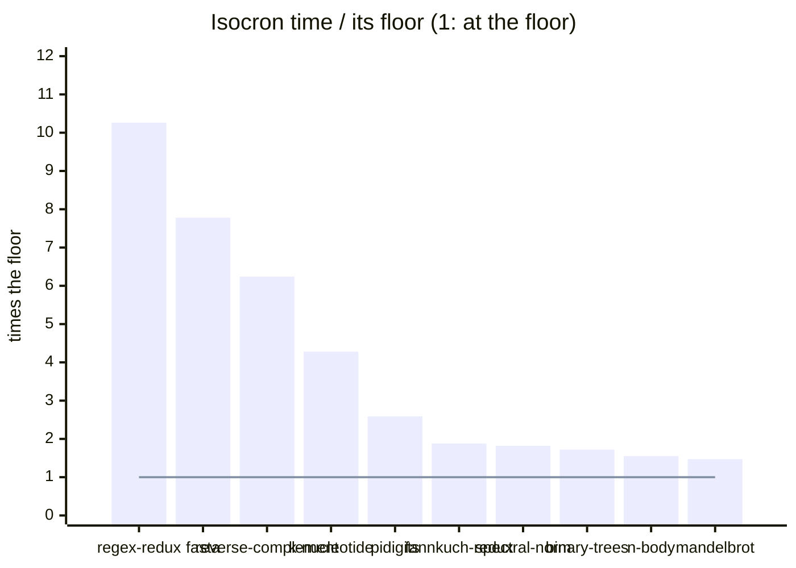

# The floors of the machine

> [!IMPORTANT]
> The floor of a program is what its result requires, under the rules of
> the Benchmarks Game (its algorithm: the trees allocated, the spigot, the
> generator, the hash tables of k-mers), times the cost of the cheapest way
> this machine has to do it. It is **never the time of a program**, ours or
> another, and it **keeps the bits** of the computation as the program
> writes it (no fused multiply-add where a product and a sum are written, no
> reordered sum: D227). A floor that a measured program beats is wrong;
> `floors.py` flags it.

Generated by `bench/floor/floors.py results/machine_floor.txt
results/machine_counts.txt results/floors_isocron.tsv
results/benchmarks_game.tsv results/floors.tsv` (DECISIONS D182, D222,
D227, D233), 2026-11-04. Times of Isocron at commit `04bb1ad`, 4 threads but
n-body and pidigits (sequential programs), lowest of 3 runs, measured in the
Docker image with the other languages (`results/benchmarks_game.tsv`), on an
Intel Xeon E-2388G at fixed frequency (`bench/machine.sh apply parallel`).

| benchmark | floor | Isocron | Isocron / floor | fastest other | its / floor | model |
| :-- | --: | --: | :-: | :-- | :-: | :-- |
| **binary-trees** | 0.395 s | 0.678 s | $\color{orange}{1.7}$ | rust-5 0.852 s | $\color{orange}{2.2}$ | each node made in an arena and visited through its pointers: 1.47 ns per node (4.42 in memory) |
| **fannkuch-redux** | 0.883 s | 1.664 s | $\color{orange}{1.9}$ | gcc-6 2.466 s | $\color{orange}{2.8}$ | 3.76e+09 flips (0.691 ns, 4 permutations per vector), 4.79e+08 permutations (1.955 ns) |
| **fasta** | 0.002 s | 0.018 s | $\color{red}{7.8}$ | rust-7 0.755 s | $\color{red}{326.4}$ | one period of the generator (139968 values, 1.029 ns) and its symbols, then 254 MB of lines copied from tables (0.0347 ns a byte) |
| **k-nucleotide** | 0.268 s | 1.148 s | $\color{red}{4.3}$ | gpp-2 1.173 s | $\color{red}{4.4}$ | read 0.027 s (4 threads), 8.75e8 counts: 0.654 ns (tables of 4096), 2.221 ns (138127 and 139882 keys for 12, 18) |
| **mandelbrot** | 0.436 s | 0.640 s | $\color{green}{1.5}$ | gpp-4 0.783 s | $\color{orange}{1.8}$ | 6.25e+09 iterations x 7.12 operations, 8 lanes per cycle |
| **n-body** | 1.316 s | 2.033 s | $\color{orange}{1.5}$ | gcc-9 1.946 s | $\color{green}{1.5}$ | latency of a step 26.3 ns (10 roots and divisions: 15.7 ns) *(estimate)* |
| **pidigits** | 0.194 s | 0.503 s | $\color{orange}{2.6}$ | gcc-2 0.681 s | $\color{red}{3.5}$ | 5.85e+08 passes over a word (mulx, adc: 0.332 ns) |
| **regex-redux** | 0.030 s | 0.305 s | $\color{red}{10.3}$ | rust-7 0.785 s | $\color{red}{26.4}$ | read 5.4 ms, 6 copies of 50.8 MB at 20.8 GB/s, 9 scans for literals (0.074 ns per byte) *(estimate)* |
| **reverse-complement** | 0.017 s | 0.105 s | $\color{red}{6.2}$ | rust 0.066 s | $\color{red}{3.9}$ | the file read twice by blocks in the caches, 30.2 GB/s |
| **spectral-norm** | 0.107 s | 0.195 s | $\color{orange}{1.8}$ | rust-6 0.205 s | $\color{orange}{1.9}$ | 1.21e+09 elements: 52 % divided (0.626 ns per core), 48 % read from memory, stored once |

Over the floor: $\color{green}{\text{up to 1.5}}$, $\color{orange}{\text{up to 3}}$, $\color{red}{\text{beyond}}$.

The reference is the machine, not another language: a program at the level
of the fastest of another language can still be far from its floor (the
fastest fasta, in Rust, is 326 times its floor).

## Order of the work

By the gap to the floor: regex-redux (the engine of masks still several
times its primitive, the vectors of the bounds of dense matches),
fasta (the lines made by vector code where copies from tables would do),
reverse-complement (the input read into new pages, a filter in two
passes), k-nucleotide (its counts in hash tables), pidigits (the dividends
of the digit made whole), then fannkuch-redux, spectral-norm,
binary-trees, n-body and mandelbrot, all below twice their floor.

## How the floors are made

<b>The work counted and the costs measured</b>

The work is counted (`bench/floor/counts.c`: flips, permutations,
iterations, k-mers; `floors.py`: the nodes of binary-trees, the passes of
pidigits on the real sizes of its numbers); the costs are measured without
Isocron (`bench/floor/floor.c`, in `results/machine_floor.txt`): bandwidths,
new pages, a file of the page cache read by every thread (into new pages,
into pages already written, by blocks that stay in the caches), an array
changed in place, the divider, square roots, fused multiply-adds,
latencies, random increments, counts in tables of 4096, the nodes of a
tree made in an arena (by a recursion, by a loop and an explicit stack),
the flips of fannkuch-redux (4 permutations per vector, 8 vectors
interleaved) and its next permutation, a big integer times a word in
assembly (mulx, adc), the generator of fasta in lanes, lines copied from a
table, two literals of 8 bytes found in a text. *(estimate)*: the model
also assumes how the work is chained (the chain of a step of n-body) or how
a pass splits into them (regex-redux).

> [!WARNING]
> Some floors are still higher than the machine allows: the flips (the next
> permutation of a done lane waits for a load) and the next permutation (a
> branch per level) could be cheaper; the tables of k-mers of 1 to 4 bases
> fit the L1 cache, counted here at the cost of 4096 counters; binary-trees
> counts the trees of depth 16 and 18 at the cost of trees in memory, though
> they fit the L3 cache. The output goes to `/dev/null`, as in the
> measurements.
